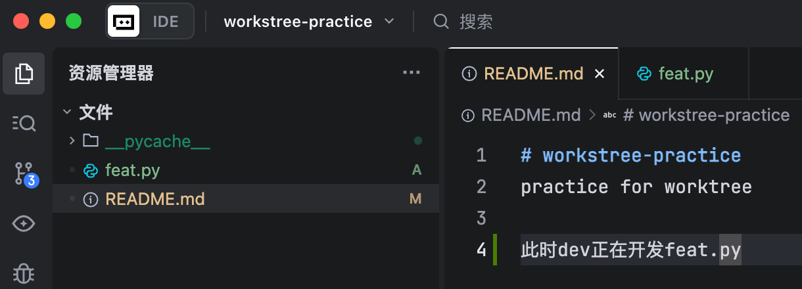
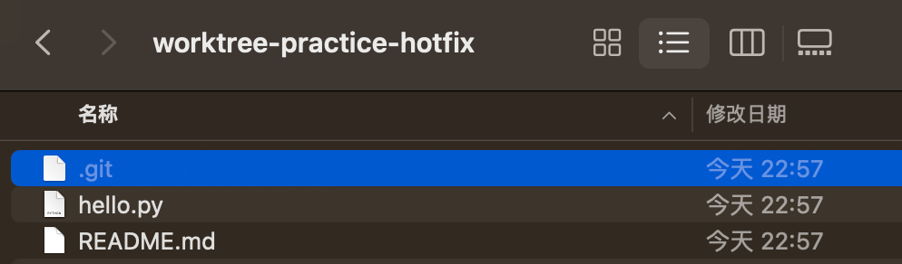

# Git worktree

## 概念

在日常开发中，我们如果需要切换分支开发的话，就会先提交当前分支的代码或者暂存起来，然后切换到目标分支进行开发。`Git worktree`允许你同时检出多个分支，每个分支在不同的文件夹，但它们共享同一个`.git`目录，从而便于管理多个分支的代码。

## 常用场景

- AI 驱动开发：在独立工作树中运行 AI 代理，以防止其覆盖本地未保存的更改。
- 紧急漏洞修复：在独立目录中处理关键问题，不会打断当前的进度。
- 并行代码审查：在本地检出和测试拉取及合并请求，而不影响现有环境、数据库状态或构建产物。
- 长时间运行的任务：在一个工作树中执行大量测试套件或复杂构建，同时在另一个工作树中继续编写代码。
- 多分支环境切换：无需储藏更改，或者等待切换分支后大量文件的重新索引，即可管理多个长期分支。

## 场景1：我正在开发一个功能，此时有紧急缺陷需要修复



此时我们需要从main分支切一个hotfix分支出来修复缺陷。

### 操作步骤

```bash
git worktree add ../worktree-practice-hotfix -b hotfix/main main
```
命令解释：
- `../worktree-practice-hotfix`：新工作树的路径，会放在当前仓库目录的同级目录下（当然你也可以指定其他绝对路径）。
- `-b hotfix/main`：在新工作树中创建并切换到名为 `hotfix/main` 的新分支。
- `main`：新分支的起点（基于 `main` 分支的当前提交）。

执行之后，会在 `../worktree-practice-hotfix` 目录下创建一个新的工作树，该工作树共享当前仓库的 `.git` 目录，但是有自己独立的目录结构和文件。`hotfix/main` 分支的代码会检检出到 `../worktree-practice-hotfix` 目录下。


我们可以看到，这个“工作副本”是一个物理上独立的文件夹，内容和当前仓库的代码是独立的，互不干扰。


我们注意到里面有一个`.git`文件：

**.git文件内容**
```text
gitdir: /Users/zhuweicong/github_project/workstree-practice/.git/worktrees/worktree-practice-hotfix
```
与主仓库`.git（是一个目录）`不同，该`.git`文件是描述了其关联的主仓库的绝对路径。